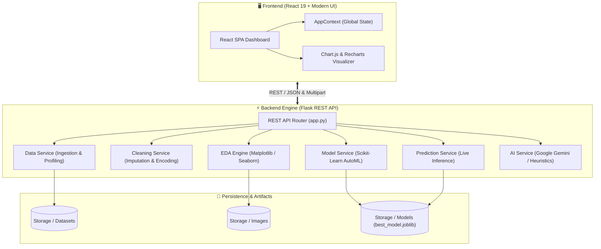

<div align="center">

# ⚡ AutoSmartML: Next-Gen Automated Machine Learning Studio

<p align="center">
  <b>Democratizing Machine Learning with Intelligent EDA, Automated Preprocessing, Multi-Model Benchmarking, and Google Gemini AI Insights.</b>
</p>

[](https://python.org)
[](https://flask.palletsprojects.com/)
[](https://react.dev/)
[](https://scikit-learn.org/)
[](https://ai.google.dev/)
[](https://docker.com)
[](LICENSE)

<br />

[Explore Features](#-interactive-features) •
[System Architecture](#-system-architecture) •
[Quick Start](#-quick-start) •
[Docker Deployment](#-docker--production-deployment) •
[API Reference](#-rest-api-reference) •
[Security & Sustainability](#-security--sustainability-audit) •
[GitHub Repo](https://github.com/HARISH19819/AutoSmartML.git)

---

</div>

## 🌟 Overview

**AutoSmartML** is a modern, full-stack, enterprise-grade Automated Machine Learning (AutoML) platform. It guides data scientists, analysts, and developers through every stage of the machine learning lifecycle—from raw CSV ingestion to automated exploratory data analysis, dataset cleaning, algorithm tournament benchmarking, live real-time inference, and downloadable production models.

Powered by **Google Gemini AI**, AutoSmartML automatically translates complex statistical distributions and correlation matrices into plain-English, actionable business intelligence.

---

## 🚀 Interactive Features

<table>
  <tr>
    <td width="50%">
      <h3>📂 1. Dataset Ingestion & Profiling</h3>
      <ul>
        <li><b>Smart Ingestion</b>: Automatic CSV schema parsing and statistical profiling.</li>
        <li><b>Column Type Inference</b>: Automatic separation into numerical and categorical dimensions.</li>
        <li><b>Null & Missing Diagnostics</b>: Instant column-wise sparsity reporting.</li>
      </ul>
    </td>
    <td width="50%">
      <h3>🧹 2. Automated Preprocessing</h3>
      <ul>
        <li><b>Deduplication</b>: Automatic detection and removal of redundant rows.</li>
        <li><b>Type-Safe Imputation</b>: Median imputation for numeric features; Mode for categorical.</li>
        <li><b>Categorical Encoding</b>: Deterministic category code transformation.</li>
      </ul>
    </td>
  </tr>
  <tr>
    <td width="50%">
      <h3>📊 3. Exploratory Data Analysis (EDA)</h3>
      <ul>
        <li><b>Distribution Histograms</b>: High-res KDE (Kernel Density Estimation) charts.</li>
        <li><b>Outlier Boxplots</b>: Interquartile Range (IQR) boundary anomaly visualization.</li>
        <li><b>Frequency Distributions</b>: Categorical frequency count bars.</li>
        <li><b>Correlation Heatmaps</b>: Multi-feature Pearson correlation matrix.</li>
      </ul>
    </td>
    <td width="50%">
      <h3>🧠 4. Gemini AI Intelligence</h3>
      <ul>
        <li><b>Executive Summaries</b>: Instant natural language dataset health checks.</li>
        <li><b>Chart Interpretation</b>: Contextual explanations for every distribution and correlation.</li>
        <li><b>Resilient Fallbacks</b>: Offline mathematical heuristic insights if API key is absent.</li>
      </ul>
    </td>
  </tr>
  <tr>
    <td width="50%">
      <h3>✂️ 5. Partitioning & Leaderboard</h3>
      <ul>
        <li><b>Train-Test Splitter</b>: Configurable validation ratio with random seeding.</li>
        <li><b>Auto-Problem Detection</b>: Automatic Classification vs. Regression identification.</li>
        <li><b>Multi-Model Tournament</b>: Benchmarks Logistic/Linear Regression, Decision Trees, and Random Forests.</li>
      </ul>
    </td>
    <td width="50%">
      <h3>🔮 6. Diagnostics & Inference</h3>
      <ul>
        <li><b>Comprehensive Metrics</b>: Accuracy, Precision, Recall, F1, RMSE, MAE, R², Adj-R².</li>
        <li><b>ROC & Confusion Matrix</b>: Binary ROC AUC curves and class attribution matrices.</li>
        <li><b>Dynamic Live Predictor</b>: Auto-generated form for real-time model inference.</li>
        <li><b>One-Click Export</b>: Download serialized <code>.joblib</code> bundle.</li>
      </ul>
    </td>
  </tr>
</table>

---

## 🏗️ System Architecture



---

## 📁 Repository Structure

```
AutoSmartML/
├── .github/                       # CI/CD workflows and repository templates
├── .dockerignore                  # Docker build exclusions
├── .gitignore                     # Git hygiene & secret protections
├── docker-compose.yml             # Unified multi-container orchestration
├── README.md                      # Comprehensive project documentation
├── backend/
│   ├── .env.example               # Backend environment template
│   ├── Dockerfile                 # Production backend container recipe
│   ├── app.py                     # Flask REST API entry point
│   ├── requirements.txt           # Python dependency specification
│   ├── test_suite.py              # Automated unit and integration tests
│   ├── ai/
│   │   └── gemini_client.py       # Google GenAI client with heuristic fallback
│   ├── services/
│   │   ├── ai_service.py          # AI prompt engineering & statistical heuristics
│   │   ├── cleaning_service.py    # Automated cleaning, imputation & encoding
│   │   ├── data_service.py        # Dataset analysis & state management
│   │   ├── eda_service.py         # Matplotlib & Seaborn visualization pipeline
│   │   ├── model_service.py       # Scikit-learn training, benchmarking & serialization
│   │   └── prediction_service.py  # Real-time feature transformation & inference
│   ├── storage/                   # File storage for datasets, plots, and models
│   └── utils/                     # Formatting, splitting, and encoding helpers
└── frontend/
    ├── .env.example               # Frontend environment template
    ├── Dockerfile                 # Production multi-stage React build container
    ├── nginx.conf                 # Production Nginx reverse-proxy configuration
    ├── package.json               # React dependencies and scripts
    ├── public/                    # Static assets and index.html
    └── src/
        ├── api.js                 # Centralized API service layer
        ├── App.js                 # Route definitions and layout wrapper
        ├── context/AppContext.js  # Global React state management
        ├── layout/                # Sidebar and MainLayout components
        ├── pages/                 # 10 dedicated AutoML workflow views
        └── styles/                # CSS design system and variables
```

---

## ⚡ Quick Start

### 📋 Prerequisites
- **Python**: 3.10 or 3.11
- **Node.js**: 18+ and `npm`
- **Git**

---

### 1️⃣ Clone the Repository
```bash
git clone https://github.com/HARISH19819/AutoSmartML.git
cd AutoSmartML
```

---

### 2️⃣ Backend Setup
```bash
cd backend

# Create and activate virtual environment
python -m venv venv

# Windows
venv\Scripts\activate

# macOS / Linux
source venv/bin/activate

# Install dependencies
pip install -r requirements.txt

# Configure environment
cp .env.example .env
# (Optional) Add your Google Gemini API key to .env:
# GEMINI_API_KEY=your_key_here

# Run automated tests
python -m unittest test_suite.py

# Launch development server
python app.py
```
> 🌐 The backend API runs at **`http://127.0.0.1:5000`**.

---

### 3️⃣ Frontend Setup
```bash
cd ../frontend

# Install dependencies
npm install

# Start React development server
npm start
```
> 💻 The frontend web dashboard will open automatically at **`http://localhost:3000`**.

---

## 🐳 Docker & Production Deployment

AutoSmartML is 100% containerized with production-ready Docker configurations.

### One-Command Launch (Docker Compose)
```bash
docker-compose up --build
```
This automatically compiles:
- **Backend**: Container running Flask via multi-worker **Gunicorn** on port `5000`.
- **Frontend**: Multi-stage production build served via high-performance **Nginx** on port `3000`.

To stop the containers:
```bash
docker-compose down
```

---

## 🔒 Security & Sustainability Audit

| Audit Dimension | Status | Implementation Details |
|:---|:---:|:---|
| **Zero Secret Leaks** | 🟢 PASSED | `.env` and `*.env` strictly ignored by `.gitignore` and `.dockerignore`. Zero secrets in git history. |
| **DoS Protection** | 🟢 PASSED | Strict `MAX_CONTENT_LENGTH = 32MB` enforced with clean HTTP 413 error handling. |
| **Path Traversal Defense** | 🟢 PASSED | Filenames sanitized via `secure_filename()`; static downloads verified with strict extension whitelists. |
| **CORS Isolation** | 🟢 PASSED | Configurable `CORS_ORIGINS` environment variable for zero-trust production domains. |
| **Thread & Memory Safety** | 🟢 PASSED | Matplotlib configured in non-interactive `Agg` mode with automated `plt.close("all")` cleanup in `finally` blocks. |
| **Resilient AI Pipeline** | 🟢 PASSED | Dual-engine architecture: Instant automatic fallback to statistical heuristic algorithms when offline. |
| **Clean Architecture** | 🟢 PASSED | Decoupled REST services with isolated responsibilities and sub-second automated test suite (14/14 tests pass). |

---

## 📡 REST API Reference

<details>
<summary><b>Click to expand full API specification</b></summary>
<br>

| Endpoint | Method | Description | Payload / Parameters |
|:---|:---:|:---|:---|
| `/` | `GET` | Service status and version check | None |
| `/health` | `GET` | Container health probe | None |
| `/upload-dataset` | `POST` | Ingest CSV dataset and generate statistical profile | `multipart/form-data` with `file` |
| `/dataset-info` | `GET` | Retrieve summary and Gemini AI insights | None |
| `/set-target` | `POST` | Select target prediction column | `{"target": "column_name"}` |
| `/clean-data` | `POST` | Execute deduplication, imputation & encoding | None |
| `/eda/numeric-columns` | `GET` | List numeric features | None |
| `/eda/categorical-columns`| `GET` | List categorical features | None |
| `/eda/histogram` | `POST` | Generate distribution KDE plot + AI insight | `{"column": "feature_name"}` |
| `/eda/boxplot` | `POST` | Generate outlier detection boxplot + AI insight | `{"column": "feature_name"}` |
| `/eda/countplot` | `POST` | Generate category frequency plot + AI insight | `{"column": "feature_name"}` |
| `/eda/heatmap` | `GET` | Generate multi-feature Pearson correlation heatmap | None |
| `/split` | `POST` | Partition dataset into train/test splits | `{"target": "col", "test_size": 0.2}` |
| `/recommend_models` | `GET` | Algorithmic recommendations for target type | `?target=column_name` |
| `/train_models` | `POST` | Run AutoML tournament benchmark | `{"target": "column_name"}` |
| `/feature_importance` | `POST` | Feature attribution ranking | `{"target": "column_name"}` |
| `/evaluate_model` | `GET`/`POST` | Diagnostics (Metrics, Confusion Matrix, ROC) | None |
| `/get_features` | `GET` | Form schema for dynamic prediction inputs | None |
| `/predict` | `POST` | Execute real-time inference | `{"feature1": val1, "feature2": val2}` |
| `/download-model` | `GET` | Download serialized `best_model.joblib` bundle | None |

</details>

---

## 🐍 Using Exported Models in Python

After downloading `best_model.joblib`, you can execute predictions anywhere in Python with zero overhead:

```python
import joblib
import pandas as pd

# 1. Load the serialized AutoSmartML bundle
bundle = joblib.load("best_model.joblib")
model = bundle["model"]
feature_columns = bundle["feature_columns"]
imputer = bundle["imputer"]
problem_type = bundle["problem_type"]

print(f"Loaded: {bundle['model_name']} ({problem_type})")

# 2. Prepare new raw input data
raw_data = {
    "age": 32,
    "salary": 72000,
    "department": "Engineering"
}
df = pd.DataFrame([raw_data])

# 3. Transform categoricals & align features
df_encoded = pd.get_dummies(df, drop_first=False)
for col in feature_columns:
    if col not in df_encoded.columns:
        df_encoded[col] = 0.0

df_aligned = df_encoded[feature_columns]

# 4. Impute & Predict
df_imputed = imputer.transform(df_aligned)
prediction = model.predict(df_imputed)

print("🎯 Prediction Result:", prediction[0])
```

---

## 🤝 Contributing

Contributions, issues, and feature requests are welcome!
1. Fork the Project
2. Create your Feature Branch (`git checkout -b feature/AmazingFeature`)
3. Commit your Changes (`git commit -m 'feat: add amazing feature'`)
4. Push to the Branch (`git push origin feature/AmazingFeature`)
5. Open a Pull Request

---

## 📄 License

Distributed under the **MIT License**. See `LICENSE` for more information.

<div align="center">
  <sub>Built with ❤️ by <a href="https://github.com/HARISH19819">HARISH19819</a> and the open-source community.</sub>
</div>
