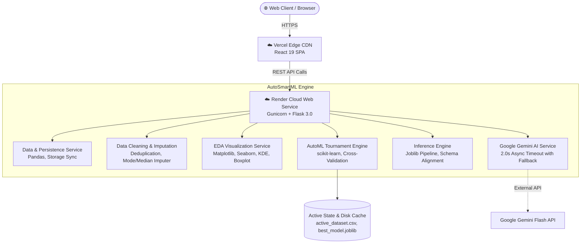

<div align="center">

# ⚡ AutoSmartML: Next-Gen Automated Machine Learning Studio

<p align="center">
  <b>Democratizing Machine Learning with Intelligent EDA, Automated Preprocessing, Multi-Model Benchmarking, and Google Gemini AI Insights.</b>
</p>

<!-- Badges -->
[](https://auto-smart-ml-skem.vercel.app)
[](https://autosmartml-backend.onrender.com)
[](https://github.com/HARISH19819/AutoSmartML.git)
<br />
[](https://python.org)
[](https://flask.palletsprojects.com/)
[](https://react.dev/)
[](https://scikit-learn.org/)
[](https://ai.google.dev/)
[](https://docker.com)
[](LICENSE)

<br />

### 🌐 Live Production Deployments
| Tier | Service | Live URL | Hosting Platform |
| :--- | :--- | :--- | :--- |
| **Frontend** | React 19 Interactive Studio SPA | [auto-smart-ml-skem.vercel.app](https://auto-smart-ml-skem.vercel.app) | **Vercel** |
| **Backend** | Python Flask + Gunicorn ML REST API | [autosmartml-backend.onrender.com](https://autosmartml-backend.onrender.com) | **Render** |
| **Source** | Full-Stack Git Repository | [HARISH19819/AutoSmartML](https://github.com/HARISH19819/AutoSmartML.git) | **GitHub** |

<br />

[Interactive Pipeline](#-end-to-end-pipeline-workflow) •
[Features](#-interactive-features) •
[Tech Stack](#-technology-stack) •
[Architecture](#-system-architecture) •
[Quick Start](#-quick-start-local-development) •
[Docker Deployment](#-docker--cloud-deployment) •
[API Reference](#-rest-api-reference)

---

</div>

## 🌟 Overview

**AutoSmartML** is an enterprise-grade Automated Machine Learning (AutoML) web studio designed to accelerate and simplify the end-to-end data science lifecycle. 

From raw CSV ingestion to automated feature distribution profiling, missing value imputation, model tournament benchmarking, ROC/confusion matrix diagnostics, and real-time interactive inference, AutoSmartML automates the repetitive complexities of machine learning.

Integrated with **Google Gemini AI**, AutoSmartML bridges statistical machine learning and human decision-making by automatically synthesizing complex metrics, distribution anomalies, and correlation matrices into plain-English business recommendations.

---

## 🔄 End-to-End Pipeline Workflow


### Detailed Pipeline Stages

1. **Dataset Ingestion**: Drag-and-drop CSV upload with 32MB streaming protection, row/column dimensions, and null sparsity detection.
2. **Schema & Target Selection**: Automatic column categorization into numerical and categorical features; configurable ML target column.
3. **Automated Preprocessing**: Deduplication, robust median imputation for numerical data, mode imputation for categorical data, and one-hot encoding.
4. **Exploratory Data Analysis (EDA)**: Interactive Kernel Density Estimation (KDE) histograms, outlier boxplots, and Pearson correlation heatmaps.
5. **Train-Test Splitting**: Automated data partitioning with customizable test ratios (5%–50%) and aligned feature schemas.
6. **AutoML Model Tournament**: Simultaneous training and benchmarking across algorithms (Linear/Logistic Regression, Decision Trees, Random Forests) with cloud-optimized hyperparameter sweeps.
7. **Comprehensive Evaluation**: R², RMSE, MAE, and Adjusted R² for regression; Accuracy, Precision, Recall, Weighted F1, Confusion Matrix, and ROC/AUC curves for classification.
8. **Production Deployment**: Real-time interactive inference form with dynamic form inputs and one-click production `.joblib` model bundle download.

---

## 🚀 Interactive Features

<table>
  <tr>
    <td width="50%">
      <h3>📂 1. Dataset Ingestion & Profiling</h3>
      <ul>
        <li><b>Smart Ingestion</b>: Automatic CSV schema parsing, dimension checking, and data preview.</li>
        <li><b>Type Inference</b>: Automatically separates numerical and categorical dimensions.</li>
        <li><b>Null Diagnostics</b>: Instant column-wise sparsity reporting.</li>
        <li><b>State Synchronization</b>: Active dataset persists seamlessly across page refreshes and browser sessions.</li>
      </ul>
    </td>
    <td width="50%">
      <h3>🧹 2. Automated Preprocessing</h3>
      <ul>
        <li><b>Deduplication</b>: Detects and drops duplicate rows automatically.</li>
        <li><b>Type-Safe Imputation</b>: Median imputation for continuous variables; Mode for discrete categories.</li>
        <li><b>Encoding</b>: Dummy feature generation preserving categorical integrity.</li>
        <li><b>Target Isolation</b>: Protects configured target features from unintended transformations.</li>
      </ul>
    </td>
  </tr>
  <tr>
    <td width="50%">
      <h3>📈 3. Exploratory Data Analysis (EDA)</h3>
      <ul>
        <li><b>Distribution Histograms</b>: High-resolution KDE curves and distribution bins.</li>
        <li><b>Outlier Boxplots</b>: IQR anomaly boundary detection.</li>
        <li><b>Frequency Distributions</b>: Categorical counts and frequencies.</li>
        <li><b>Correlation Heatmaps</b>: Multi-feature Pearson correlation matrices.</li>
      </ul>
    </td>
    <td width="50%">
      <h3>🤖 4. AutoML Model Tournament</h3>
      <ul>
        <li><b>Problem Type Auto-Detection</b>: Dynamically identifies regression vs. binary vs. multiclass classification.</li>
        <li><b>Multi-Model Benchmarking</b>: Linear/Logistic Regression, Decision Trees, and Random Forests.</li>
        <li><b>Metric Leaderboard</b>: R² for regression; Accuracy and F1-Score for classification.</li>
        <li><b>Cloud Speed Optimized</b>: Fast-converging solvers for rapid execution on free cloud hosting.</li>
      </ul>
    </td>
  </tr>
  <tr>
    <td width="50%">
      <h3>🔥 5. Feature Importance & Diagnostics</h3>
      <ul>
        <li><b>Gini Importance</b>: Quantifies the predictive power of each input feature.</li>
        <li><b>Model Diagnostics</b>: Confusion matrices and ROC curves with AUC calculation.</li>
        <li><b>Overfitting Protection</b>: Separate train vs. test evaluation splits.</li>
      </ul>
    </td>
    <td width="50%">
      <h3>🔮 6. Real-Time Inference & Export</h3>
      <ul>
        <li><b>Dynamic Form Generation</b>: Inference inputs dynamically match training feature types.</li>
        <li><b>Instant Predictions</b>: Real-time single-sample inference via active champion model.</li>
        <li><b>Production Bundle</b>: Download serialized <code>.joblib</code> bundle containing the fitted model, imputer, and feature column map.</li>
      </ul>
    </td>
  </tr>
</table>

---

## 🛠️ Technology Stack

<div align="center">

| Domain | Technology | Purpose |
| :--- | :--- | :--- |
| **Frontend UI** | [React 19](https://react.dev/) | Reactive Single-Page Application (SPA) architecture |
| **Routing** | [React Router 7](https://reactrouter.com/) | Client-side routing with SPA rewrite fallbacks |
| **Data Viz** | [Chart.js 4](https://www.chartjs.org/) & [Recharts 3](https://recharts.org/) | Interactive responsive charting and metric visualization |
| **Backend API** | [Flask 3](https://flask.palletsprojects.com/) | Lightweight, modular Python REST API microservice |
| **WSGI Server** | [Gunicorn 21](https://gunicorn.org/) | Multi-worker production HTTP server |
| **Machine Learning**| [scikit-learn 1.3+](https://scikit-learn.org/) | Preprocessing, model training, benchmarking, and metrics |
| **Data Science** | [Pandas 2](https://pandas.pydata.org/) & [NumPy 1.24+](https://numpy.org/) | Tabular data manipulation and numerical computation |
| **Data Visuals** | [Matplotlib 3.7](https://matplotlib.org/) & [Seaborn 0.12](https://seaborn.pydata.org/) | High-resolution statistical chart rendering |
| **Generative AI** | [Google Gemini API](https://ai.google.dev/) | Automated dataset insights, cleaning summaries, and chart analysis |
| **Serialization**| [Joblib 1.3+](https://joblib.readthedocs.io/) | Production model artifact persistence |
| **Web Server** | [Nginx Alpine](https://nginx.org/) | Production container web server for static assets |
| **Orchestration**| [Docker](https://docker.com) & [Docker Compose](https://docs.docker.com/compose/) | Containerized multi-service deployment |
| **Cloud Hosting** | [Vercel](https://vercel.com) & [Render](https://render.com) | Zero-cost continuous deployment from GitHub |

</div>

---

## 📐 System Architecture



---

## ⚡ Quick Start: Local Development

### Prerequisites
- **Python 3.10+** (Tested on Python 3.11)
- **Node.js 18+** or **20+**
- **Git**

### 1. Clone the Repository
```bash
git clone https://github.com/HARISH19819/AutoSmartML.git
cd AutoSmartML
```

### 2. Configure Backend
```bash
cd backend

# Create and activate virtual environment
python -m venv venv
# On Windows:
venv\Scripts\activate
# On Linux/macOS:
source venv/bin/activate

# Install dependencies
pip install -r requirements.txt

# (Optional) Add your Google Gemini API Key
echo GEMINI_API_KEY=your_key_here > .env

# Run the Flask backend server
python app.py
```
> The backend server starts at **`http://127.0.0.1:5000`**.

### 3. Configure Frontend
```bash
# In a new terminal window:
cd frontend

# Install Node dependencies
npm install

# Start the React development server
npm start
```
> The React dashboard opens automatically at **`http://localhost:3000`**.

---

## 🐳 Docker & Cloud Deployment

### Multi-Container Deployment with Docker Compose

AutoSmartML includes ready-to-run containerization configs for single-command production deployment:

```bash
# Build and run backend (port 5000) and frontend (port 3000)
docker compose up -d --build

# Verify running containers
docker compose ps
```

- **Frontend Application**: `http://localhost:3000`
- **Backend API**: `http://localhost:5000/health`

---

### Cloud Deployment (Free Tier: Render + Vercel)

#### 1. Backend on Render (Web Service)
1. Fork or push this repository to GitHub.
2. Sign in to [Render](https://render.com) and create a **New Web Service**.
3. Select your `AutoSmartML` repository.
4. Set:
   - **Root Directory**: `backend`
   - **Environment**: `Python 3`
   - **Build Command**: `pip install -r requirements.txt`
   - **Start Command**: `gunicorn --bind 0.0.0.0:$PORT --workers 2 --timeout 120 app:app`
   - **Instance Type**: `Free`
5. Add Environment Variables:
   - `FLASK_DEBUG`: `False`
   - `CORS_ORIGINS`: `*`
   - `GEMINI_API_KEY`: *(Optional) Your Gemini Key*
6. Click **Deploy Web Service** and copy your live backend URL (e.g. `https://autosmartml-backend.onrender.com`).

#### 2. Frontend on Vercel
1. Sign in to [Vercel](https://vercel.com) and click **Add New...** > **Project**.
2. Select `AutoSmartML`.
3. In Project Settings:
   - **Root Directory**: Edit and set to **`frontend`**
   - **Framework**: `Create React App`
4. In **Environment Variables**:
   - **Key**: `REACT_APP_API_URL`
   - **Value**: `https://autosmartml-backend.onrender.com` *(your Render backend URL)*
5. Click **Deploy**.

---

## 📡 REST API Reference

| Endpoint | Method | Description | Payload / Query |
| :--- | :---: | :--- | :--- |
| `/health` | `GET` | Service health status check | None |
| `/pipeline-state` | `GET` | Fetches active dataset dimensions, target, and model status | None |
| `/upload-dataset` | `POST` | Uploads and profiles CSV dataset | `multipart/form-data` (`file`) |
| `/dataset-info` | `GET` | Returns summary statistics, sample rows, and AI insights | None |
| `/set-target` | `POST` | Sets the supervised ML target feature | `{"target": "column_name"}` |
| `/clean-data` | `POST` | Executes automated deduplication and median/mode imputation | `{"target": "column_name"}` |
| `/eda/numeric-columns` | `GET` | Lists all detected numeric columns | None |
| `/eda/categorical-columns`| `GET` | Lists all detected categorical columns | None |
| `/eda/histogram` | `GET` | Generates KDE distribution histogram | `?column=col_name` |
| `/eda/boxplot` | `GET` | Generates outlier boxplot | `?column=col_name` |
| `/eda/countplot` | `GET` | Generates categorical frequency counts | `?column=col_name` |
| `/eda/heatmap` | `GET` | Generates Pearson correlation heatmap | None |
| `/split` | `POST` | Splits active dataset into train/test partitions | `{"target": "col", "test_size": 0.2}` |
| `/recommend_models` | `GET` | AI-recommended algorithms based on schema | None |
| `/train_models` | `POST` | Trains and benchmarks all candidate ML models | `{"target": "col"}` |
| `/feature_importance` | `POST` | Calculates Gini predictive importance per feature | `{"target": "col"}` |
| `/evaluate_model` | `GET` | Returns metrics, confusion matrix, and ROC curve | None |
| `/get_features` | `GET` | Schema definitions for dynamic inference form | None |
| `/predict` | `POST` | Live real-time single-sample inference | `{"features": {"col1": val, ...}}` |
| `/download-model` | `GET` | Downloads serialized `best_model.joblib` | None |

---

## 🔒 Security & Sustainability Audit Highlights

- **DoS Mitigation**: Enforced `MAX_CONTENT_LENGTH = 32MB` with custom HTTP 413 handling to reject unbounded file streams.
- **Configurable CORS**: Dynamic origin whitelisting via `CORS_ORIGINS` with guaranteed headers across all error responses.
- **Path Traversal Protection**: All file paths validated and sanitized via `werkzeug.utils.secure_filename`.
- **Thread Safety**: Matplotlib configured with `Agg` backend and thread-safe temp directory (`MPLCONFIGDIR`) preventing concurrency deadlocks.
- **Non-Blocking AI**: Google Gemini calls encapsulated with a 2.0-second async timeout and automatic fallback to statistical summaries.
- **Memory Leak Prevention**: Explicit `matplotlib.pyplot.close("all")` called in `finally` blocks after every chart generation.
- **Robust State Persistence**: Dual-layer state sync across browser `localStorage` and disk-backed `active_dataset.csv` guarantees seamless workflow across page reloads.

---

## 👨‍💻 Author & Contributing

Created by **[HARISH19819](https://github.com/HARISH19819)**.

Contributions, feature requests, and suggestions are welcome!
1. Fork the Project
2. Create your Feature Branch (`git checkout -b feature/AmazingFeature`)
3. Commit your Changes (`git commit -m 'Add some AmazingFeature'`)
4. Push to the Branch (`git push origin feature/AmazingFeature`)
5. Open a Pull Request

---

<div align="center">
  <sub>Built with ❤️ using Python, Flask, React, scikit-learn, and Google Gemini AI.</sub>
</div>
